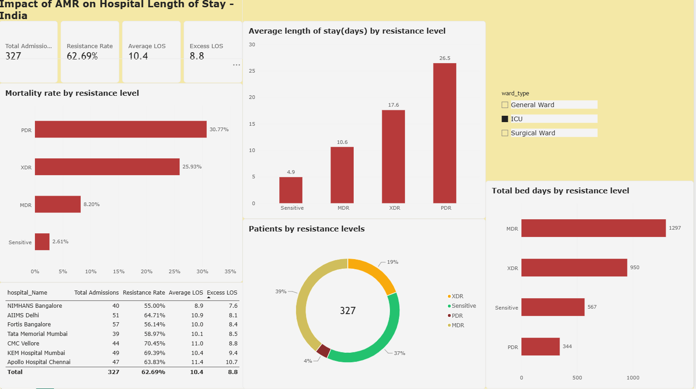
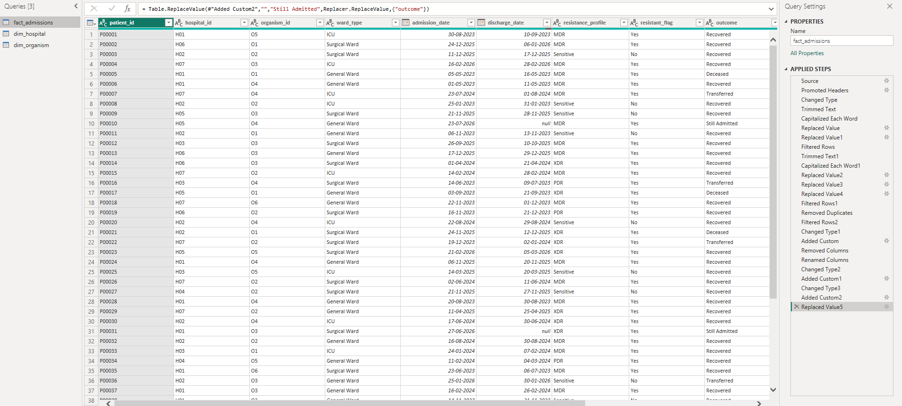
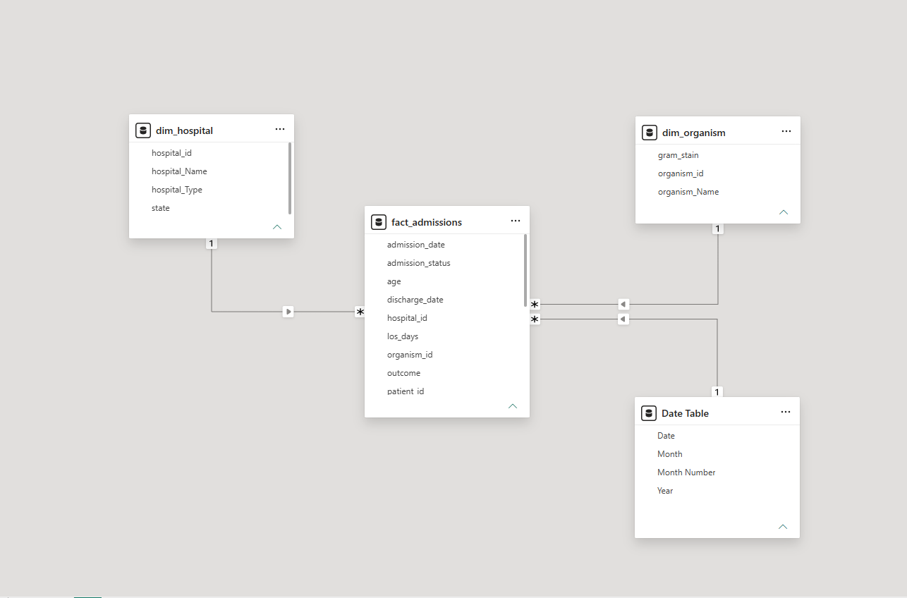

# Impact of AMR on Hospital Length of Stay — India

A Power BI dashboard analysing how antimicrobial resistance (AMR) affects hospital length of stay and mortality in India, paired with a management case study. Linked to my MSc dissertation: *"Impact of Antimicrobial Resistance (AMR) on Length of Hospital Stays in India: A Scoping Review."*



## Key Findings

- **62.9%** of 1,000 admissions involved a resistant infection
- Resistant infections added **9.4 extra days** in hospital on average
- Length of stay rose with resistance: **5.0 days** (Sensitive) → **10.8** (MDR) → **17.9** (XDR) → **27.6** (PDR)
- Mortality rose in the same pattern: **1.8%** → **10.0%** → **26.0%** → **41.5%**
- MDR patients used the **most bed days overall**, despite PDR patients having the longest individual stays, which matters for capacity planning

## Skills Demonstrated

**Data cleaning (Power Query)**
- Trimmed whitespace and standardised inconsistent text (e.g. "icu", " ICU", "GENERAL WARD")
- Standardised Yes/No values (Y, yes, YES → Yes)
- Removed duplicate records
- Handled invalid ages and calculated length of stay from admission and discharge dates
- Fixed import issues (headers loaded as data)



**Data modelling**
- Star schema: one fact table (admissions), two dimension tables (hospitals, organisms) and a date table, linked with one-to-many relationships



**DAX**

```dax
Total Admissions = COUNTROWS(fact_admissions)

Average LOS = AVERAGE(fact_admissions[los_days])

Resistant Cases = CALCULATE(COUNTROWS(fact_admissions), fact_admissions[resistant_flag] = "Yes")

Resistance Rate = DIVIDE([Resistant Cases], [Total Admissions])

Avg LOS Resistant = CALCULATE([Average LOS], fact_admissions[resistant_flag] = "Yes")

Avg LOS Sensitive = CALCULATE([Average LOS], fact_admissions[resistant_flag] = "No")

Excess LOS = [Avg LOS Resistant] - [Avg LOS Sensitive]

Mortality Rate = DIVIDE(
    CALCULATE(COUNTROWS(fact_admissions), fact_admissions[outcome] = "Deceased"),
    CALCULATE(COUNTROWS(fact_admissions), fact_admissions[admission_status] = "Discharged")
)

Total Bed Days = SUM(fact_admissions[los_days])
```

## Contents

- `Indian Hospital_AMR_Dashboard.pbix` — Power BI file
- `AMR and Hospital Length of Stay in India.pdf` — management case study with findings and recommendations
- `01_dashboard.png` to `04_dax_measures.png` — dashboard, data model, data cleaning and DAX views

## Data Note

This project uses **synthetic data** created for learning and portfolio purposes. It is designed to reflect patterns reported in AMR research, but it is **not real patient data**, and the figures should not be cited as evidence.

## License

© 2026 Ashlesha. All Rights Reserved.

This project is shared publicly for portfolio and demonstration purposes only. No part of this repository (code, data, documentation) may be copied, reused, modified, or redistributed without explicit written permission from the author.
